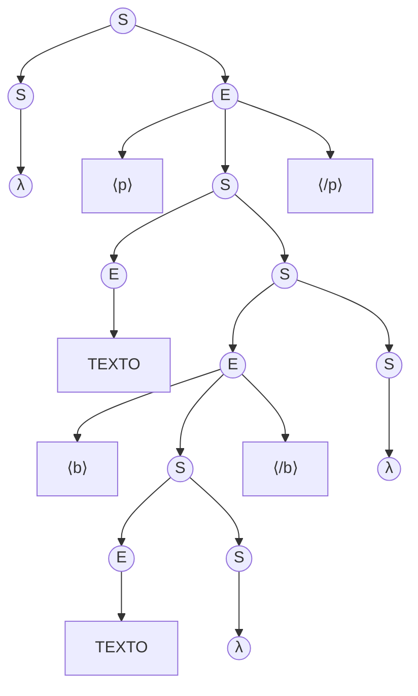
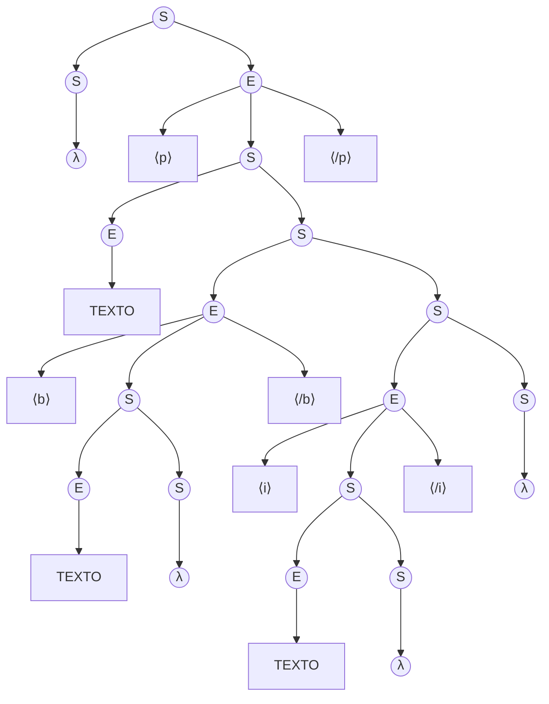

# Fase 1: Especificación Formal de una Gramática Libre de Contexto ($G$)

**Materia:** Lenguajes Formales y Autómatas (2026)  
**Proyecto:** Analizador Sintáctico para MiniHTML  
**Documento:** Especificación Formal y Justificación Teórica de la Fase 1

---

## 1. Fundamentación Teórica y Contexto

En la teoría de lenguajes formales (Jerarquía de Chomsky), los lenguajes se clasifican según el poder computacional del modelo requerido para generarlos y reconocerlos:

1. **Insuficiencia de los Lenguajes Regulares (Clase 6):**  
   Los lenguajes regulares son generados por gramáticas regulares y reconocidos por Autómatas Finitos (AF). La característica fundamental de un AF es que dispone únicamente de una cantidad finita de estados internos y carece de memoria auxiliar dinámica.  
   El lenguaje **MiniHTML** exige validar que las etiquetas de apertura (`<b>`, `<i>`, `<p>`) se cierren con su correspondiente etiqueta (`</b>`, `</i>`, `</p>`) en orden estricto **LIFO** (*Last-In, First-Out*), permitiendo niveles arbitrarios y no acotados de anidamiento.
   
   Por el **Lema de Bombeo para Lenguajes Regulares** (*Pumping Lemma*, visto en Clase 6), cualquier lenguaje que requiera emparejamiento no acotado de símbolos (como el lenguaje de paréntesis balanceados $L_{pb}$ o $L = \{a^n b^n \mid n \ge 0\}$) **no es regular**, ya que un número finito de estados no puede recordar un conteo arbitrario de aperturas pendientes.

2. **Necesidad de una Gramática Libre de Contexto (Clase 7):**  
   Para modelar el anidamiento y la estructura jerárquica de MiniHTML, es imperativo recurrir a los **Lenguajes Independientes de Contexto (LIC)** (Tipo 2 de Chomsky), generados mediante una **Gramática Libre o Independiente de Contexto (GLC / GIC)** y reconocibles computacionalmente mediante un **Autómata con Pila (AP)**.

---

## 2. Definición Formal de la Gramática ($G$)

Formalmente, definimos la gramática libre de contexto como una 4-tupla:
$$G = (V, \Sigma, S, P)$$

### 2.1. Símbolos Terminales ($\Sigma$)
Son los elementos atómicos e indivisibles que componen las cadenas del lenguaje. Conforme al alfabeto estipulado en la consigna:
$$\Sigma = \{ \lt\text{b}\gt, \lt\text{i}\gt, \lt\text{p}\gt, \lt/\text{b}\gt, \lt/\text{i}\gt, \lt/\text{p}\gt, \text{TEXTO} \}$$

En el código fuente de MiniHTML, estos terminales corresponden a los siguientes tokens:
* Etiquetas de apertura: `<b>`, `<i>`, `<p>`
* Etiquetas de cierre: `</b>`, `</i>`, `</p>`
* Contenido textual plano: `TEXTO`

### 2.2. Variables No Terminales ($V$)
Son los símbolos sintácticos auxiliares que estructuran las reglas de derivación:
$$V = \{ S, E \}$$

* **$S$ (Secuencia / Contenido):** Representa una secuencia ordenada de cero o más elementos sintácticos. Modela tanto el documento completo como el contenido interno encerrado entre un par de etiquetas.
* **$E$ (Elemento):** Representa una unidad sintáctica indivisible dentro de la secuencia: puede ser un bloque de texto plano o una estructura completa delimitada por etiquetas de apertura y cierre.

### 2.3. Símbolo Inicial ($S$)
Es la variable no terminal a partir de la cual se inicia toda derivación válida del lenguaje:
$$\text{Símbolo Inicial} = S$$

### 2.4. Reglas de Producción ($P$)
El conjunto finito de reglas de producción está conformado por:

| N° | Regla de Producción | Notación de Tokens | Descripción Sintáctica |
|:--:|:--------------------|:-------------------|:-----------------------|
| **1** | $S \rightarrow E \ S$ | $S \rightarrow E \ S$ | Descompone una secuencia en un elemento seguido por el resto de la secuencia. |
| **2** | $S \rightarrow \lambda$ | $S \rightarrow \lambda$ | Clausura de la secuencia (palabra vacía $\lambda$). Permite documentos o etiquetas vacías. |
| **3** | $E \rightarrow \text{TEXTO}$ | $E \rightarrow \text{TEXTO}$ | Un elemento puede ser texto plano sin formato. |
| **4** | $E \rightarrow \lt\text{b}\gt \ S \ \lt/\text{b}\gt$ | $E \rightarrow \text{<b>} \ S \ \text{</b>}$ | Bloque en negrita delimitado por sus etiquetas, conteniendo recursivamente una secuencia $S$. |
| **5** | $E \rightarrow \lt\text{i}\gt \ S \ \lt/\text{i}\gt$ | $E \rightarrow \text{<i>} \ S \ \text{</i>}$ | Bloque en cursiva delimitado por sus etiquetas, conteniendo recursivamente una secuencia $S$. |
| **6** | $E \rightarrow \lt\text{p}\gt \ S \ \lt/\text{p}\gt$ | $E \rightarrow \text{<p>} \ S \ \text{</p>}$ | Bloque de párrafo delimitado por sus etiquetas, conteniendo recursivamente una secuencia $S$. |

---

## 3. Justificación Teórica del Diseño de la Gramática

1. **Garantía del principio LIFO y Anidamiento Estricto:**  
   En las reglas 4, 5 y 6 ($E \rightarrow \lt\text{tag}\gt \ S \ \lt/\text{tag}\gt$), la etiqueta de apertura y su correspondiente etiqueta de cierre son introducidas de forma simultánea en la misma producción. El contenido interno $S$ queda estrictamente encerrado en medio de ambas. Por lo tanto, cualquier etiqueta abierta dentro de $S$ debe completarse y cerrarse en su totalidad antes de que se pueda derivar el cierre de la etiqueta contenedora, satisfaciendo formalmente el comportamiento de pila LIFO.

2. **Modularidad y Concatenación:**  
   La combinación de la regla recursiva por la derecha ($S \rightarrow E \ S$) junto con la regla base ($S \rightarrow \lambda$) permite modelar la concatenación de un número arbitrario ($k \ge 0$) de elementos contiguos al mismo nivel jerárquico (por ejemplo: texto seguido de negrita, seguido de párrafo).

3. **Ausencia de Ambigüedad:**  
   Una gramática es ambigua si existe al menos una cadena del lenguaje que admita más de un árbol de derivación sintáctica (o dos derivaciones por la izquierda distintas).  
   Al desacoplar el rol de la secuencia ($S$) del rol del elemento ($E$), cada token terminal entrante determina unívocamente qué regla de producción debe aplicarse en una derivación más a la izquierda:
   * Si el token es texto plano o una etiqueta de apertura (`<b>`, `<i>`, `<p>`), $S$ debe expandirse mediante la Regla 1 ($S \rightarrow E \ S$) y luego $E$ selecciona de manera determinista la regla según el token específico (Reglas 3, 4, 5 o 6).
   * Si nos encontramos ante una etiqueta de cierre o el fin de la cadena, $S$ debe derivar obligatoriamente en $\lambda$ (Regla 2).  
   Esto asegura que la gramática sea **determinista y no ambigua**, propiedad fundamental para construir un analizador sintáctico descendente recursivo (Fase 3).

---

## 4. Análisis de la Gramática: Árboles de Derivación y Derivaciones

Un **árbol de derivación sintáctica** (o árbol de análisis sintáctico) es una representación gráfica de la estructura jerárquica de una derivación según las siguientes propiedades teóricas (Clase 7):
* La raíz está rotulada con el símbolo inicial $S$.
* Cada nodo interno está rotulado con una variable no terminal de $V$.
* Si un nodo interno $A$ tiene hijos $X_1, X_2, \dots, X_n$, entonces existe una producción $A \rightarrow X_1 X_2 \dots X_n \in P$.
* Cada hoja está rotulada con un símbolo terminal de $\Sigma$ o con la palabra vacía $\lambda$.
* El producto del árbol (leído ordenadamente de izquierda a derecha en las hojas) coincide exactamente con la cadena derivada.

> **Nota de visualización:** En los diagramas de árbol se utilizan los corchetes angulares matemáticos `⟨tag⟩` y `⟨/tag⟩` para representar los tokens terminales de apertura y cierre sin colisionar con las etiquetas internas de HTML del navegador.

---

### 4.1. Análisis de la Cadena $\alpha$

$$\alpha = \text{<p> TEXTO <b> TEXTO </b> </p>}$$

#### Árbol de Derivación Sintáctica para $\alpha$



#### Derivación Más a la Izquierda (Leftmost Derivation) para $\alpha$

En cada paso se reemplaza la variable no terminal situada más a la izquierda:

1. $S \Rightarrow E \ S$ *(por Regla 1: $S \rightarrow E \ S$)*
2. $\Rightarrow \lt\text{p}\gt S \lt/\text{p}\gt S$ *(por Regla 6: $E \rightarrow \lt\text{p}\gt S \lt/\text{p}\gt$)*
3. $\Rightarrow \lt\text{p}\gt E \ S \lt/\text{p}\gt S$ *(por Regla 1: $S \rightarrow E \ S$)*
4. $\Rightarrow \lt\text{p}\gt \text{TEXTO} \ S \lt/\text{p}\gt S$ *(por Regla 3: $E \rightarrow \text{TEXTO}$)*
5. $\Rightarrow \lt\text{p}\gt \text{TEXTO} \ E \ S \lt/\text{p}\gt S$ *(por Regla 1: $S \rightarrow E \ S$)*
6. $\Rightarrow \lt\text{p}\gt \text{TEXTO} \ \lt\text{b}\gt S \lt/\text{b}\gt S \lt/\text{p}\gt S$ *(por Regla 4: $E \rightarrow \lt\text{b}\gt S \lt/\text{b}\gt$)*
7. $\Rightarrow \lt\text{p}\gt \text{TEXTO} \ \lt\text{b}\gt E \ S \lt/\text{b}\gt S \lt/\text{p}\gt S$ *(por Regla 1: $S \rightarrow E \ S$)*
8. $\Rightarrow \lt\text{p}\gt \text{TEXTO} \ \lt\text{b}\gt \text{TEXTO} \ S \lt/\text{b}\gt S \lt/\text{p}\gt S$ *(por Regla 3: $E \rightarrow \text{TEXTO}$)*
9. $\Rightarrow \lt\text{p}\gt \text{TEXTO} \ \lt\text{b}\gt \text{TEXTO} \ \lambda \lt/\text{b}\gt S \lt/\text{p}\gt S$ *(por Regla 2: $S \rightarrow \lambda$)*
10. $\Rightarrow \lt\text{p}\gt \text{TEXTO} \ \lt\text{b}\gt \text{TEXTO} \lt/\text{b}\gt \lambda \lt/\text{p}\gt S$ *(por Regla 2: $S \rightarrow \lambda$)*
11. $\Rightarrow \lt\text{p}\gt \text{TEXTO} \ \lt\text{b}\gt \text{TEXTO} \lt/\text{b}\gt \lt/\text{p}\gt \lambda$ *(por Regla 2: $S \rightarrow \lambda$)*
12. $\Rightarrow \lt\text{p}\gt \text{TEXTO} \ \lt\text{b}\gt \text{TEXTO} \lt/\text{b}\gt \lt/\text{p}\gt$ *(Cadena terminal obtenida: $\alpha$)*

Cadena final resultante:
```html
<p> TEXTO <b> TEXTO </b> </p>
```

---

### 4.2. Análisis de la Cadena $\beta$

$$\beta = \text{<p> TEXTO <b> TEXTO </b> <i> TEXTO </i> </p>}$$

#### Árbol de Derivación Sintáctica para $\beta$



#### Derivación Más a la Izquierda (Leftmost Derivation) para $\beta$

La derivación comparte los primeros pasos (1 al 9) con la cadena $\alpha$. En el paso 10, en lugar de clausurar la secuencia interior de `<p>` con $\lambda$, se expande $S$ para incorporar el elemento contiguo `<i>`:

1. $S \Rightarrow E \ S$ *(Regla 1)*
2. $\Rightarrow \lt\text{p}\gt S \lt/\text{p}\gt S$ *(Regla 6)*
3. $\Rightarrow \lt\text{p}\gt E \ S \lt/\text{p}\gt S$ *(Regla 1)*
4. $\Rightarrow \lt\text{p}\gt \text{TEXTO} \ S \lt/\text{p}\gt S$ *(Regla 3)*
5. $\Rightarrow \lt\text{p}\gt \text{TEXTO} \ E \ S \lt/\text{p}\gt S$ *(Regla 1)*
6. $\Rightarrow \lt\text{p}\gt \text{TEXTO} \ \lt\text{b}\gt S \lt/\text{b}\gt S \lt/\text{p}\gt S$ *(Regla 4)*
7. $\Rightarrow \lt\text{p}\gt \text{TEXTO} \ \lt\text{b}\gt E \ S \lt/\text{b}\gt S \lt/\text{p}\gt S$ *(Regla 1)*
8. $\Rightarrow \lt\text{p}\gt \text{TEXTO} \ \lt\text{b}\gt \text{TEXTO} \ S \lt/\text{b}\gt S \lt/\text{p}\gt S$ *(Regla 3)*
9. $\Rightarrow \lt\text{p}\gt \text{TEXTO} \ \lt\text{b}\gt \text{TEXTO} \ \lambda \lt/\text{b}\gt S \lt/\text{p}\gt S$ *(Regla 2)*
10. $\Rightarrow \lt\text{p}\gt \text{TEXTO} \ \lt\text{b}\gt \text{TEXTO} \lt/\text{b}\gt E \ S \lt/\text{p}\gt S$ *(por Regla 1: $S \rightarrow E \ S$)*
11. $\Rightarrow \lt\text{p}\gt \text{TEXTO} \ \lt\text{b}\gt \text{TEXTO} \lt/\text{b}\gt \lt\text{i}\gt S \lt/\text{i}\gt S \lt/\text{p}\gt S$ *(por Regla 5: $E \rightarrow \lt\text{i}\gt S \lt/\text{i}\gt$)*
12. $\Rightarrow \lt\text{p}\gt \text{TEXTO} \ \lt\text{b}\gt \text{TEXTO} \lt/\text{b}\gt \lt\text{i}\gt E \ S \lt/\text{i}\gt S \lt/\text{p}\gt S$ *(por Regla 1: $S \rightarrow E \ S$)*
13. $\Rightarrow \lt\text{p}\gt \text{TEXTO} \ \lt\text{b}\gt \text{TEXTO} \lt/\text{b}\gt \lt\text{i}\gt \text{TEXTO} \ S \lt/\text{i}\gt S \lt/\text{p}\gt S$ *(por Regla 3: $E \rightarrow \text{TEXTO}$)*
14. $\Rightarrow \lt\text{p}\gt \text{TEXTO} \ \lt\text{b}\gt \text{TEXTO} \lt/\text{b}\gt \lt\text{i}\gt \text{TEXTO} \ \lambda \lt/\text{i}\gt S \lt/\text{p}\gt S$ *(por Regla 2: $S \rightarrow \lambda$)*
15. $\Rightarrow \lt\text{p}\gt \text{TEXTO} \ \lt\text{b}\gt \text{TEXTO} \lt/\text{b}\gt \lt\text{i}\gt \text{TEXTO} \lt/\text{i}\gt \lambda \lt/\text{p}\gt S$ *(por Regla 2: $S \rightarrow \lambda$)*
16. $\Rightarrow \lt\text{p}\gt \text{TEXTO} \ \lt\text{b}\gt \text{TEXTO} \lt/\text{b}\gt \lt\text{i}\gt \text{TEXTO} \lt/\text{i}\gt \lt/\text{p}\gt \lambda$ *(por Regla 2: $S \rightarrow \lambda$)*
17. $\Rightarrow \lt\text{p}\gt \text{TEXTO} \ \lt\text{b}\gt \text{TEXTO} \lt/\text{b}\gt \lt\text{i}\gt \text{TEXTO} \lt/\text{i}\gt \lt/\text{p}\gt$ *(Cadena terminal obtenida: $\beta$)*

Cadena final resultante:
```html
<p> TEXTO <b> TEXTO </b> <i> TEXTO </i> </p>
```

---

## 5. Conclusión de la Fase 1 y Preparación para la Fase 2

Con la especificación de la gramática $G = (V, \Sigma, S, P)$ y el análisis formal de las cadenas $\alpha$ y $\beta$:
1. Se demostró formalmente que el lenguaje de MiniHTML es un Lenguaje Independiente de Contexto (LIC).
2. Se estableció un modelo no ambiguo que respeta estrictamente el anidamiento LIFO.
3. Se proporcionan los cimientos para diseñar en la **Fase 2** el **Autómata a Pila ($M$)**, cuya pila modelará de forma exacta el comportamiento de la sustitución de las variables no terminales $S$ y $E$ aquí desarrolladas.
