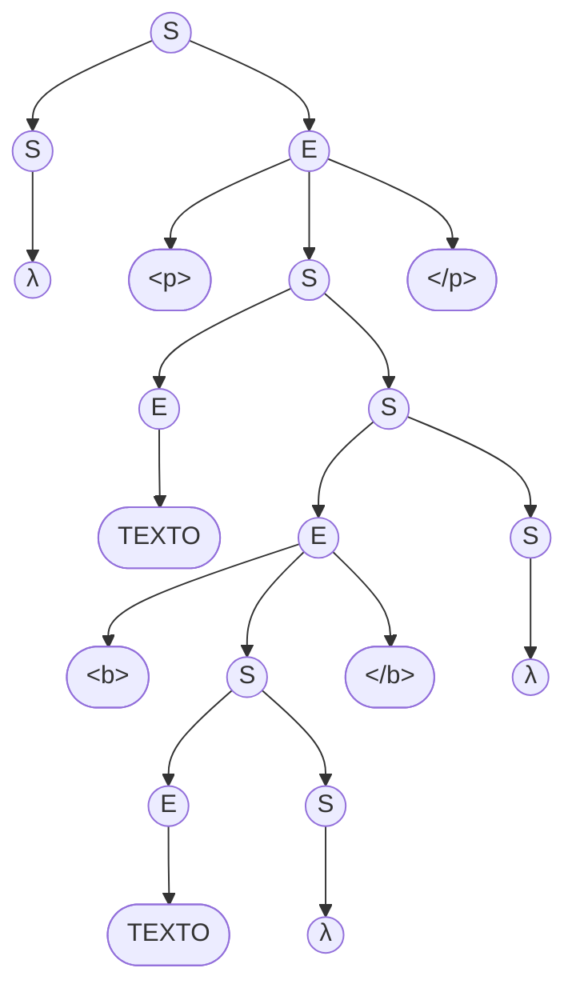
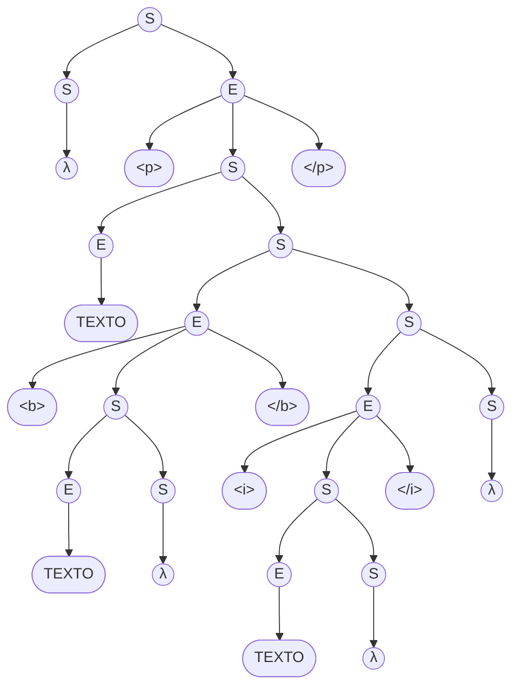

# Fase 1: Especificación formal de una gramática libre de contexto (G)

Para diseñar el analizador sintáctico de MiniHTML, primero formalizamos su estructura mediante una Gramática Libre de Contexto (GLC).

## 1. Definición de la Gramática

Formalmente, definimos la gramática $G = (V, \Sigma, S, P)$ como una 4-tupla, donde:

*   **Símbolos Terminales ($\Sigma$):** Son los caracteres y tokens indivisibles del lenguaje.
    $$\Sigma = \{ \text{<b>}, \text{<i>}, \text{
}, \text{</b>}, \text{</i>}, \text{
}, \text{TEXTO} \}$$

*   **Variables No Terminales ($V$):** Son las variables sintácticas que generan el lenguaje. 
    Definimos dos variables para mantener la gramática simple y no ambigua:
    $$V = \{ S, E \}$$
    *Donde $S$ representa una secuencia de elementos (el documento o el contenido de una etiqueta) y $E$ representa un único elemento (texto plano o un bloque de etiquetas).*

*   **Símbolo Inicial ($S$):** El punto de partida de la gramática.

*   **Reglas de Producción ($P$):**
    1.  $S \rightarrow E \ S$
    2.  $S \rightarrow \lambda$
    3.  $E \rightarrow \text{TEXTO}$
    4.  $E \rightarrow \text{<b>} \ S \ \text{</b>}$
    5.  $E \rightarrow \text{<i>} \ S \ \text{</i>}$
    6.  $E \rightarrow \text{
} \ S \ \text{
}$

**Justificación del diseño:** 
La regla $S \rightarrow E \ S \ | \ \lambda$ permite generar una lista de cero o más elementos consecutivos (texto seguido de etiqueta, o múltiples etiquetas anidadas). Las reglas de $E$ aseguran el anidamiento LIFO de las etiquetas, ya que cada apertura (ej. `<b>`) obliga a que se genere su cierre correspondiente (`</b>`), conteniendo una nueva secuencia $S$ en su interior.

---

## 2. Análisis de la gramática (Árboles de derivación sintáctica)

A continuación, mostramos los árboles de derivación para las dos cadenas de prueba solicitadas.

### Cadena $\alpha = \text{
 TEXTO <b> TEXTO </b> 
}$

**Derivación por la izquierda para $\alpha$:**
$S \Rightarrow E \ S \Rightarrow \text{
} \ S \ \text{
} \ S \Rightarrow \text{
} \ E \ S \ \text{
} \ S \Rightarrow \text{
} \ \text{TEXTO} \ S \ \text{
} \ S \Rightarrow \text{
} \ \text{TEXTO} \ E \ S \ \text{
} \ S \Rightarrow \text{
} \ \text{TEXTO} \ \text{<b>} \ S \ \text{</b>} \ S \ \text{
} \ S \Rightarrow \text{
} \ \text{TEXTO} \ \text{<b>} \ E \ S \ \text{</b>} \ S \ \text{
} \ S \Rightarrow \text{
} \ \text{TEXTO} \ \text{<b>} \ \text{TEXTO} \ S \ \text{</b>} \ S \ \text{
} \ S \Rightarrow \text{
} \ \text{TEXTO} \ \text{<b>} \ \text{TEXTO} \ \lambda \ \text{</b>} \ \lambda \ \text{
} \ \lambda \Rightarrow \text{
} \ \text{TEXTO} \ \text{<b>} \ \text{TEXTO} \ \text{</b>} \ \text{
}$

---

### Cadena $\beta = \text{
 TEXTO <b> TEXTO </b> <i> TEXTO </i> 
}$

**Derivación por la izquierda para $\beta$:**
El procedimiento es idéntico a $\alpha$ hasta procesar `</b>`. En vez de que $S$ evalúe a $\lambda$, se expande a $E \ S$ nuevamente para generar la etiqueta `<i>`:
$... \Rightarrow \text{
} \ \text{TEXTO} \ \text{<b>} \ \text{TEXTO} \ \text{</b>} \ S \ \text{
} \ S \Rightarrow \text{
} \ \text{TEXTO} \ \text{<b>} \ \text{TEXTO} \ \text{</b>} \ E \ S \ \text{
} \ S \Rightarrow \text{
} \ \text{TEXTO} \ \text{<b>} \ \text{TEXTO} \ \text{</b>} \ \text{<i>} \ S \ \text{</i>} \ S \ \text{
} \ S \Rightarrow \text{
} \ \text{TEXTO} \ \text{<b>} \ \text{TEXTO} \ \text{</b>} \ \text{<i>} \ E \ S \ \text{</i>} \ S \ \text{
} \ S \Rightarrow \text{
} \ \text{TEXTO} \ \text{<b>} \ \text{TEXTO} \ \text{</b>} \ \text{<i>} \ \text{TEXTO} \ \lambda \ \text{</i>} \ \lambda \ \text{
} \ \lambda \Rightarrow \text{
} \ \text{TEXTO} \ \text{<b>} \ \text{TEXTO} \ \text{</b>} \ \text{<i>} \ \text{TEXTO} \ \text{</i>} \ \text{
}$
