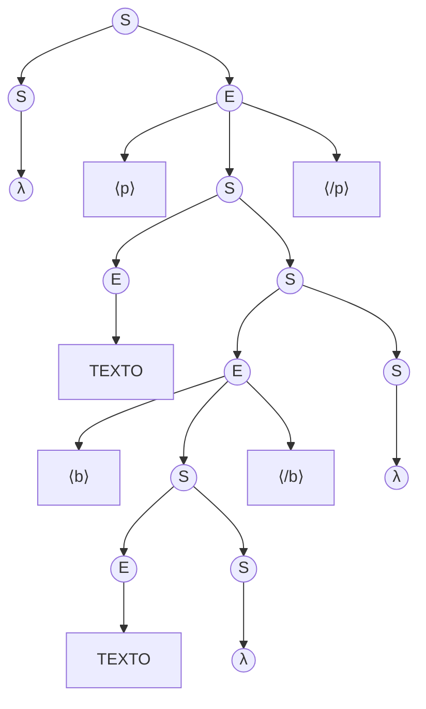
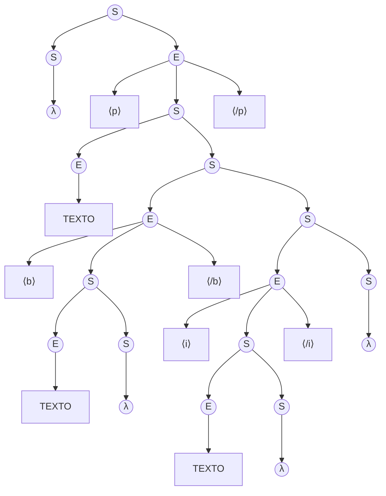

# Fase 1: Especificación Formal de una Gramática Libre de Contexto ($G$)

**Materia:** Lenguajes Formales y Autómatas (2026)  
**Proyecto:** Analizador Sintáctico para MiniHTML  
**Documento:** Especificación Formal y Justificación Teórica de la Fase 1

---

## 1. Fundamentación Teórica y Contexto

En la teoría de lenguajes formales (Jerarquía de Chomsky), los lenguajes se clasifican según el poder del modelo formal requerido para generarlos y reconocerlos:

### 1.1. Insuficiencia de los Lenguajes Regulares (Clase 6)
Los lenguajes regulares son generados por gramáticas regulares y reconocidos por Autómatas Finitos (AF). La limitación estructural de un AF es que dispone únicamente de una cantidad finita de estados y carece de memoria auxiliar dinámica.

El lenguaje **MiniHTML** exige validar que las etiquetas de apertura (`<b>`, `<i>`, `<p>`) se cierren con su correspondiente etiqueta (`</b>`, `</i>`, `</p>`) en orden estricto **LIFO** (*Last-In, First-Out*), admitiendo niveles arbitrarios y no acotados de anidamiento.

Por el **Lema de Bombeo para Lenguajes Regulares** (*Pumping Lemma*, Clase 6), todo lenguaje que requiera balanceo o emparejamiento no acotado de símbolos (como el lenguaje de paréntesis balanceados $L_{pb}$ o $L = \{a^n b^n \mid n \ge 0\}$) **no es regular**, dado que ningún autómata de estados finitos puede recordar cuántas etiquetas abiertas tiene pendientes de cerrar.

### 1.2. Necesidad de una Gramática Libre de Contexto (Clase 7)
Para modelar la estructura jerárquica y el anidamiento estricto de MiniHTML, es necesario recurrir a los **Lenguajes Independientes de Contexto (LIC)** (Tipo 2 de Chomsky), generados por una **Gramática Libre o Independiente de Contexto (GLC / GIC)** y reconocibles mediante un **Autómata con Pila (AP)**.

---

## 2. Definición Formal de la Gramática ($G$)

Formalmente, definimos la gramática libre de contexto como una 4-tupla:

$$G = (V, \Sigma, S, P)$$

### 2.1. Símbolos Terminales ($\Sigma$)
El alfabeto terminal está compuesto por los 7 tokens indivisibles definidos en la consigna:

$$\Sigma = \{ \langle b \rangle, \langle i \rangle, \langle p \rangle, \langle /b \rangle, \langle /i \rangle, \langle /p \rangle, \text{TEXTO} \}$$

En el código fuente de MiniHTML corresponden a:
* **Etiquetas de apertura:** `<b>`, `<i>`, `<p>`
* **Etiquetas de cierre:** `</b>`, `</i>`, `</p>`
* **Contenido plano:** `TEXTO`

### 2.2. Variables No Terminales ($V$)
Son las variables sintácticas que estructuran las reglas:

$$V = \{ S, E \}$$

* **`S` (Secuencia / Contenido):** Representa una secuencia de cero o más elementos. Modela tanto el documento completo como el contenido interno que se encuentra dentro de cualquier etiqueta.
* **`E` (Elemento individual):** Representa una unidad sintáctica atómica: puede ser un bloque de texto plano o una estructura delimitada por una etiqueta de apertura y su correspondiente etiqueta de cierre.

### 2.3. Símbolo Inicial ($S$)
Es la variable desde la cual se inicia toda derivación válida:

$$\text{Símbolo Inicial} = S$$

### 2.4. Reglas de Producción ($P$)
El conjunto de producciones está definido por:

| N° | Regla | Descripción Sintáctica |
|:--:|:---|:---|
| **1** | `S -> E S` | Una secuencia se expande en un elemento seguido de otra secuencia. |
| **2** | `S -> λ` | Clausura de la secuencia mediante la palabra vacía $\lambda$ (permite documentos o etiquetas sin contenido). |
| **3** | `E -> TEXTO` | Un elemento puede ser texto plano sin formato. |
| **4** | `E -> <b> S </b>` | Un elemento en negrita con contenido interno `S` delimitado por `<b>` y `</b>`. |
| **5** | `E -> <i> S </i>` | Un elemento en cursiva con contenido interno `S` delimitado por `<i>` y `</i>`. |
| **6** | `E -> <p> S </p>` | Un elemento de párrafo con contenido interno `S` delimitado por `<p>` y `</p>`. |

---

## 3. Justificación Teórica del Diseño

1. **Garantía del principio LIFO y Anidamiento Estricto:**  
   En las reglas 4, 5 y 6 (`E -> <tag> S </tag>`), la apertura y el cierre se generan de manera simultánea en la misma producción, dejando la variable `S` encerrada en su interior. En consecuencia, cualquier etiqueta generada dentro de `S` debe completarse y cerrarse en su totalidad antes de poder derivar el cierre de la etiqueta contenedora, satisfaciendo el orden LIFO.

2. **Modularidad y Concatenación:**  
   La recursividad por la derecha (`S -> E S`) combinada con la producción nula (`S -> λ`) permite concatenar $k \ge 0$ elementos consecutivos al mismo nivel jerárquico (por ejemplo: un párrafo seguido de negrita).

3. **Ausencia de Ambigüedad:**  
   Al separar la secuencia (`S`) del elemento atómico (`E`), la gramática es **no ambigua**. Cada token entrante determina unívocamente la regla a aplicar en una derivación más a la izquierda:
   * Ante un token de texto o apertura (`TEXTO`, `<b>`, `<i>`, `<p>`), se aplica determinísticamente la Regla 1 (`S -> E S`) y luego `E` se expande con la regla correspondiente.
   * Ante una etiqueta de cierre (`</b>`, `</i>`, `</p>`) o fin de cadena, `S` deriva obligatoriamente en `λ` (Regla 2).

---

## 4. Análisis de la Gramática: Árboles de Derivación y Trazas

Un **árbol de derivación sintáctica** representa gráficamente el proceso de derivación:
* La raíz es el símbolo inicial `S`.
* Los nodos internos corresponden a variables no terminales (`S`, `E`).
* Las hojas corresponden a símbolos terminales o a la palabra vacía `λ`.
* La lectura de las hojas de izquierda a derecha produce exactamente la cadena evaluada.

---

### 4.1. Cadena $\alpha$

* **Cadena objetivo:** `<p> TEXTO <b> TEXTO </b> </p>`

#### Árbol Sintáctico de $\alpha$



#### Derivación Más a la Izquierda (Leftmost Derivation) de $\alpha$

En cada paso se sustituye la variable no terminal situada más a la izquierda:

```text
Paso   Cadena generada en la derivación                     Regla aplicada
---------------------------------------------------------------------------------------
01.    S                                                    (Símbolo inicial)
02.    => E S                                               (Regla 1: S -> E S)
03.    => <p> S </p> S                                      (Regla 6: E -> <p> S </p>)
04.    => <p> E S </p> S                                    (Regla 1: S -> E S)
05.    => <p> TEXTO S </p> S                                (Regla 3: E -> TEXTO)
06.    => <p> TEXTO E S </p> S                              (Regla 1: S -> E S)
07.    => <p> TEXTO <b> S </b> S </p> S                     (Regla 4: E -> <b> S </b>)
08.    => <p> TEXTO <b> E S </b> S </p> S                   (Regla 1: S -> E S)
09.    => <p> TEXTO <b> TEXTO S </b> S </p> S               (Regla 3: E -> TEXTO)
10.    => <p> TEXTO <b> TEXTO λ </b> S </p> S               (Regla 2: S -> λ)
11.    => <p> TEXTO <b> TEXTO </b> λ </p> S                 (Regla 2: S -> λ)
12.    => <p> TEXTO <b> TEXTO </b> </p> λ                   (Regla 2: S -> λ)
13.    => <p> TEXTO <b> TEXTO </b> </p>                     (Cadena final α obtenida)
```

---

### 4.2. Cadena $\beta$

* **Cadena objetivo:** `<p> TEXTO <b> TEXTO </b> <i> TEXTO </i> </p>`

#### Árbol Sintáctico de $\beta$



#### Derivación Más a la Izquierda (Leftmost Derivation) de $\beta$

```text
Paso   Cadena generada en la derivación                              Regla aplicada
-----------------------------------------------------------------------------------------------------------
01.    S                                                             (Símbolo inicial)
02.    => E S                                                        (Regla 1: S -> E S)
03.    => <p> S </p> S                                               (Regla 6: E -> <p> S </p>)
04.    => <p> E S </p> S                                             (Regla 1: S -> E S)
05.    => <p> TEXTO S </p> S                                         (Regla 3: E -> TEXTO)
06.    => <p> TEXTO E S </p> S                                       (Regla 1: S -> E S)
07.    => <p> TEXTO <b> S </b> S </p> S                              (Regla 4: E -> <b> S </b>)
08.    => <p> TEXTO <b> E S </b> S </p> S                            (Regla 1: S -> E S)
09.    => <p> TEXTO <b> TEXTO S </b> S </p> S                        (Regla 3: E -> TEXTO)
10.    => <p> TEXTO <b> TEXTO λ </b> S </p> S                        (Regla 2: S -> λ)
11.    => <p> TEXTO <b> TEXTO </b> E S </p> S                        (Regla 1: S -> E S)
12.    => <p> TEXTO <b> TEXTO </b> <i> S </i> S </p> S               (Regla 5: E -> <i> S </i>)
13.    => <p> TEXTO <b> TEXTO </b> <i> E S </i> S </p> S             (Regla 1: S -> E S)
14.    => <p> TEXTO <b> TEXTO </b> <i> TEXTO S </i> S </p> S         (Regla 3: E -> TEXTO)
15.    => <p> TEXTO <b> TEXTO </b> <i> TEXTO λ </i> S </p> S         (Regla 2: S -> λ)
16.    => <p> TEXTO <b> TEXTO </b> <i> TEXTO </i> λ </p> S           (Regla 2: S -> λ)
17.    => <p> TEXTO <b> TEXTO </b> <i> TEXTO </i> </p> λ             (Regla 2: S -> λ)
18.    => <p> TEXTO <b> TEXTO </b> <i> TEXTO </i> </p>               (Cadena final β obtenida)
```

---

## 5. Conclusión de la Fase 1 y Enlace con la Fase 2

Con esta formalización:
1. Se demostró que MiniHTML es un **Lenguaje Independiente de Contexto (LIC)** que no puede ser procesado por un Autómata Finito debido a la necesidad de memoria LIFO.
2. Se estableció una gramática **libre de ambigüedad** y matemáticamente consistente.
3. Se detallaron las derivaciones y árboles sintácticos para las cadenas de prueba requeridas.
4. Queda establecida la base formal para la **Fase 2**, donde el **Autómata a Pila ($M$)** implementará las transiciones push/pop correspondientes a este modelo.
