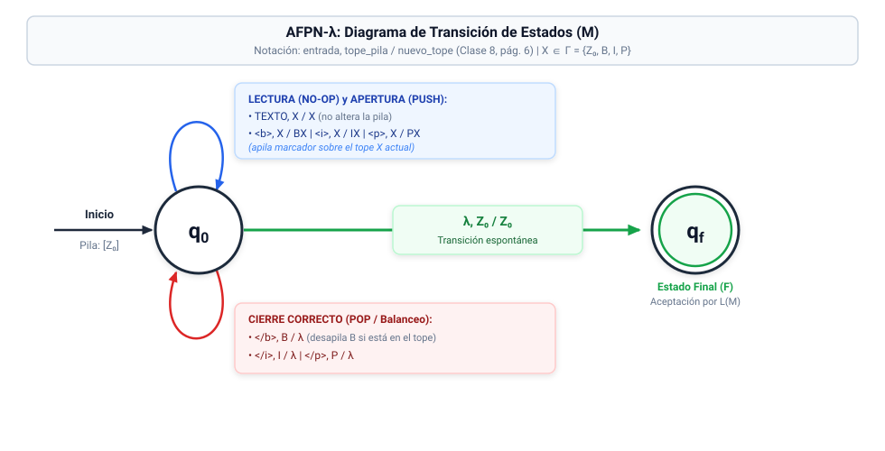

# Fase 2: Diseño Formal del Autómata a Pila ($M$)

**Materia:** Lenguajes Formales y Autómatas (2026)  
**Proyecto:** Analizador Sintáctico para MiniHTML  
**Documento:** Especificación Formal del AFPN-λ y Trazas (Basado en Clase 8)

---

## 1. Justificación del Modelo y Comparación Teórica (Clase 8)

Como se analizó en la **Clase 8 (Autómatas a Pila y Lenguajes independientes de contexto)**:
* Un Autómata Finito tradicional carece de memoria auxiliar. Para reconocer un Lenguaje Independiente de Contexto (LIC) como MiniHTML, se equipa al autómata con un dispositivo de memoria tipo **pila LIFO** (Clase 8, diapositiva 2).
* **Mecanismos de aceptación (Clase 8, diapositivas 12-14):**
  * **$L(M)$ (Aceptación por estado final):** La cadena se acepta si al procesar todos los símbolos se alcanza un estado en $F$.
  * **$N(M)$ (Aceptación por vaciado de pila):** La cadena se acepta si la pila queda vacía tras consumir toda la entrada.
* **Modelo seleccionado:** Diseñamos un **Autómata Finito con Pila No Determinista con transiciones espontáneas (AFPN-$\lambda$)** por estado final $L(M)$ con marcador de fondo $Z_0$ (Clase 8, diapositivas 7-10; la consigna admite APD o APND). Cada etiqueta de apertura apila su marcador correspondiente; el texto no altera la pila; y cada etiqueta de cierre desapila su marcador si coincide con el tope. Cuando la pila vuelve a $Z_0$, el autómata puede transicionar espontáneamente ($\lambda$) al estado de aceptación $q_f$.
* **¿Por qué no es determinista?** En la Clase 8 la función del AFPD es $\delta: Q \times \Sigma \times \Gamma \to Q \times \Gamma^*$, sin transiciones $\lambda$. Nuestro autómata necesita la transición $\Delta(q_0, \lambda, Z_0) = \{(q_f, Z_0)\}$ para aceptar, y esta coexiste con las lecturas desde $q_0$ con tope $Z_0$ (por ejemplo $\Delta(q_0, \langle p\rangle, Z_0)$): con tope $Z_0$ la máquina puede leer **o** saltar a $q_f$. Ese es el **único punto de no determinismo**; todas las demás transiciones tienen a lo sumo una opción.
* **Sin ambigüedad en la práctica:** la rama que toma la transición $\lambda$ antes de terminar la entrada muere en $q_f$ (que no tiene transiciones salientes) sin haber consumido $w$. Por eso la única rama que puede aceptar es la que salta a $q_f$ con la entrada ya consumida, y es la que sigue el simulador de la Fase 3.

---

## 2. Definición Formal del Autómata a Pila ($M$)

Conforme a la definición de la **Clase 8 (diapositivas 7-10)**, definimos formalmente el AFPN-$\lambda$ como la 7-upla:

$$M = (\Sigma, \Gamma, Q, q_0, Z_0, F, \Delta)$$

Donde:

### 2.1. Alfabeto de Entrada ($\Sigma$)
Los 7 símbolos terminales del lenguaje MiniHTML:
$$\Sigma = \{ \langle\text{b}\rangle, \langle\text{i}\rangle, \langle\text{p}\rangle, \langle/\text{b}\rangle, \langle/\text{i}\rangle, \langle/\text{p}\rangle, \text{TEXTO} \}$$

### 2.2. Alfabeto de la Pila ($\Gamma$)
Símbolos utilizados en la cinta de memoria (pila):
$$\Gamma = \{ Z_0, B, I, P \}$$
* $Z_0$: Símbolo inicial de la pila (marcador de fondo).
* $B$: Marcador de etiqueta de negrita abierta (`<b>`).
* $I$: Marcador de etiqueta de cursiva abierta (`<i>`).
* $P$: Marcador de etiqueta de párrafo abierta (`<p>`).

### 2.3. Conjunto Finito de Estados ($Q$)
$$Q = \{ q_0, q_f \}$$
* $q_0$: Estado inicial y de procesamiento de lectura.
* $q_f$: Estado final de aceptación.

### 2.4. Estado Inicial ($q_0$)
$$q_0 \in Q$$

### 2.5. Símbolo Inicial de la Pila ($Z_0$)
$$Z_0 \in \Gamma$$

### 2.6. Conjunto de Estados Finales ($F$)
$$F = \{ q_f \}$$

---

## 3. Función de Transición ($\Delta$)

Siguiendo la definición del AFPN-$\lambda$ de la **Clase 8 (diapositivas 7-10)**:
$$\Delta: Q \times (\Sigma \cup \{\lambda\}) \times \Gamma \rightarrow \mathcal{P}(Q \times \Gamma^*)$$

Donde $(q', \gamma) \in \Delta(q, a, z)$ significa que estando en el estado $q$, leyendo el símbolo $a$ (o sin leer nada si $a = \lambda$) y con el símbolo $z$ en el tope de la pila, el autómata puede transicionar al estado $q'$ y **reemplazar el tope $z$ por la cadena $\gamma$**.

> **Notación:** como cada $\Delta(q, a, z)$ de este autómata tiene a lo sumo un elemento, en la tabla y las trazas escribimos $\Delta(q, a, z) = (q', \gamma)$ como abreviatura de $\Delta(q, a, z) = \{(q', \gamma)\}$.

* Si $\gamma = Yz$: Operación **PUSH** (se apila $Y$ sobre $z$).
* Si $\gamma = z$: Operación **NO-OP** (se conserva el tope $z$).
* Si $\gamma = \lambda$: Operación **POP** (se desapila el tope $z$).

### Tabla Formal de Transiciones

| N° | Estado ($q$) | Entrada ($a$) | Tope ($z$) | $\Delta(q, a, z) = (q', \gamma)$ | Operación | Justificación Teórica |
|:--:|:---:|:---:|:---:|:---:|:---:|:---|
| **1** | $q_0$ | `TEXTO` | $X \in \Gamma$ | $(q_0, X)$ | No-op | El texto plano no altera el anidamiento. |
| **2** | $q_0$ | `<b>` | $X \in \Gamma$ | $(q_0, BX)$ | Push | Apila $B$ para recordar que se abrió `<b>`. |
| **3** | $q_0$ | `<i>` | $X \in \Gamma$ | $(q_0, IX)$ | Push | Apila $I$ para recordar que se abrió `<i>`. |
| **4** | $q_0$ | `<p>` | $X \in \Gamma$ | $(q_0, PX)$ | Push | Apila $P$ para recordar que se abrió `<p>`. |
| **5** | $q_0$ | `</b>` | $B$ | $(q_0, \lambda)$ | Pop | Cierre correcto de `<b>`: desapila $B$. |
| **6** | $q_0$ | `</i>` | $I$ | $(q_0, \lambda)$ | Pop | Cierre correcto de `<i>`: desapila $I$. |
| **7** | $q_0$ | `</p>` | $P$ | $(q_0, \lambda)$ | Pop | Cierre correcto de `<p>`: desapila $P$. |
| **8** | $q_0$ | $\lambda$ | $Z_0$ | $(q_f, Z_0)$ | Aceptación | Entrada consumida y pila en $Z_0$ $\rightarrow$ pasa a $q_f$. |

> **Bloqueo formal:** Para cualquier combinación no listada (ejemplo: leer `</b>` con tope $P$ o $Z_0$), $\Delta = \emptyset$, produciendo el bloqueo inmediato y el rechazo de la cadena por violación sintáctica LIFO.

---

## 4. Diagrama de Transición del Autómata (Clase 8, pág. 6)

Convención de rotulado: `entrada, tope_pila / nuevo_tope`  
Donde $X \in \Gamma = \{Z_0, B, I, P\}$ representa cualquier símbolo en el tope de la pila.

<div align="center">
  
  <p><em>Figura 2.1: Diagrama de transición formal del AFPN-λ con nodos circulares (q₀ y estado final doble círculo q_f) según la convención de la Clase 8.</em></p>
</div>

<br/>

### Representación en Código Mermaid

```mermaid
flowchart LR
    %% Estados con notación formal de autómata (círculo y doble círculo)
    inicio(["Inicio<br/>Pila: [Z₀]"]) --> q0(( "q₀" ))
    
    %% Transición espontánea de aceptación hacia el estado final
    q0 -->|"λ, Z₀ / Z₀<br/><i>(Transición espontánea)</i>"| qf((( "q_f" )))
    
    %% Bucle de procesamiento sobre q0 (Lectura, Push y Pop)
    q0 -->|"<b>1. Lectura (No-op):</b><br/>• TEXTO, X / X<br/><br/><b>2. Aperturas (Push):</b><br/>• &lt;b&gt;, X / BX<br/>• &lt;i&gt;, X / IX<br/>• &lt;p&gt;, X / PX<br/><br/><b>3. Cierres (Pop):</b><br/>• &lt;/b&gt;, B / λ<br/>• &lt;/i&gt;, I / λ<br/>• &lt;/p&gt;, P / λ"| q0
```

---

## 5. Trazas de Configuración Instantánea (Clase 8, pág. 11)

Según la definición formal de la **Clase 8 (diapositiva 11)**, una configuración instantánea es la terna:
$$(q, \omega, \gamma)$$
Donde $q$ es el estado actual, $\omega$ la entrada remanente, y $\gamma$ el contenido de la pila (con el tope escrito a la izquierda: $\gamma = X\zeta$).
Un paso de procesamiento se denota como:
$$(q, a\omega', X\zeta) \vdash (p, \omega', \eta\zeta) \quad \text{si } (p, \eta) \in \Delta(q, a, X)$$

---

### 5.1. Traza para la Cadena $\alpha$
$$\alpha = \text{<p> TEXTO <b> TEXTO </b> </p>}$$

```text
Paso   Configuración Instantánea                                             Transición Aplicada (Δ)
--------------------------------------------------------------------------------------------------------------------------
01.    (q0,  <p> TEXTO <b> TEXTO </b> </p>,                   Z0)             Configuración inicial
02.    |- (q0,  TEXTO <b> TEXTO </b> </p>,                   P Z0)            Regla 4: Δ(q0, <p>, Z0) = (q0, P Z0)
03.    |- (q0,  <b> TEXTO </b> </p>,                         P Z0)            Regla 1: Δ(q0, TEXTO, P) = (q0, P)
04.    |- (q0,  TEXTO </b> </p>,                           B P Z0)            Regla 2: Δ(q0, <b>, P) = (q0, B P)
05.    |- (q0,  </b> </p>,                                 B P Z0)            Regla 1: Δ(q0, TEXTO, B) = (q0, B)
06.    |- (q0,  </p>,                                        P Z0)            Regla 5: Δ(q0, </b>, B) = (q0, λ)
07.    |- (q0,  λ,                                             Z0)            Regla 7: Δ(q0, </p>, P) = (q0, λ)
08.    |- (qf,  λ,                                             Z0)            Regla 8: Δ(q0, λ, Z0) = (qf, Z0)
--------------------------------------------------------------------------------------------------------------------------
Resultado: Cadena ACEPTADA (qf ∈ F, entrada consumida y pila en Z0). w ∈ L(M).
```

---

### 5.2. Traza para la Cadena $\beta$
$$\beta = \text{<p> TEXTO <b> TEXTO </b> <i> TEXTO </i> </p>}$$

```text
Paso   Configuración Instantánea                                             Transición Aplicada (Δ)
--------------------------------------------------------------------------------------------------------------------------
01.    (q0,  <p> TEXTO <b> TEXTO </b> <i> TEXTO </i> </p>,    Z0)             Configuración inicial
02.    |- (q0,  TEXTO <b> TEXTO </b> <i> TEXTO </i> </p>,    P Z0)            Regla 4: Δ(q0, <p>, Z0) = (q0, P Z0)
03.    |- (q0,  <b> TEXTO </b> <i> TEXTO </i> </p>,          P Z0)            Regla 1: Δ(q0, TEXTO, P) = (q0, P)
04.    |- (q0,  TEXTO </b> <i> TEXTO </i> </p>,            B P Z0)            Regla 2: Δ(q0, <b>, P) = (q0, B P)
05.    |- (q0,  </b> <i> TEXTO </i> </p>,                  B P Z0)            Regla 1: Δ(q0, TEXTO, B) = (q0, B)
06.    |- (q0,  <i> TEXTO </i> </p>,                         P Z0)            Regla 5: Δ(q0, </b>, B) = (q0, λ)
07.    |- (q0,  TEXTO </i> </p>,                           I P Z0)            Regla 3: Δ(q0, <i>, P) = (q0, I P)
08.    |- (q0,  </i> </p>,                                 I P Z0)            Regla 1: Δ(q0, TEXTO, I) = (q0, I)
09.    |- (q0,  </p>,                                        P Z0)            Regla 6: Δ(q0, </i>, I) = (q0, λ)
10.    |- (q0,  λ,                                             Z0)            Regla 7: Δ(q0, </p>, P) = (q0, λ)
11.    |- (qf,  λ,                                             Z0)            Regla 8: Δ(q0, λ, Z0) = (qf, Z0)
--------------------------------------------------------------------------------------------------------------------------
Resultado: Cadena ACEPTADA (qf ∈ F, entrada consumida y pila en Z0). w ∈ L(M).
```

---

### 5.3. Traza para la Cadena $\gamma$
$$\gamma = \text{<p> TEXTO TEXTO </p> <i> TEXTO </i>}$$

```text
Paso   Configuración Instantánea                                             Transición Aplicada (Δ)
--------------------------------------------------------------------------------------------------------------------------
01.    (q0,  <p> TEXTO TEXTO </p> <i> TEXTO </i>,             Z0)             Configuración inicial
02.    |- (q0,  TEXTO TEXTO </p> <i> TEXTO </i>,             P Z0)            Regla 4: Δ(q0, <p>, Z0) = (q0, P Z0)
03.    |- (q0,  TEXTO </p> <i> TEXTO </i>,                   P Z0)            Regla 1: Δ(q0, TEXTO, P) = (q0, P)
04.    |- (q0,  </p> <i> TEXTO </i>,                         P Z0)            Regla 1: Δ(q0, TEXTO, P) = (q0, P)
05.    |- (q0,  <i> TEXTO </i>,                                Z0)            Regla 7: Δ(q0, </p>, P) = (q0, λ)
06.    |- (q0,  TEXTO </i>,                                  I Z0)            Regla 3: Δ(q0, <i>, Z0) = (q0, I Z0)
07.    |- (q0,  </i>,                                        I Z0)            Regla 1: Δ(q0, TEXTO, I) = (q0, I)
08.    |- (q0,  λ,                                             Z0)            Regla 6: Δ(q0, </i>, I) = (q0, λ)
09.    |- (qf,  λ,                                             Z0)            Regla 8: Δ(q0, λ, Z0) = (qf, Z0)
--------------------------------------------------------------------------------------------------------------------------
Resultado: Cadena ACEPTADA (qf ∈ F, entrada consumida y pila en Z0). w ∈ L(M).
```

---

### 5.4. Demostración de Rechazo (Cadena Inválida)
$$\text{Inválida} = \text{<p> <b> TEXTO </p> </b>}$$

```text
Paso   Configuración Instantánea                                             Transición Aplicada / Evento
--------------------------------------------------------------------------------------------------------------------------
01.    (q0,  <p> <b> TEXTO </p> </b>,                         Z0)             Configuración inicial
02.    |- (q0,  <b> TEXTO </p> </b>,                         P Z0)            Δ(q0, <p>, Z0) = (q0, P Z0)
03.    |- (q0,  TEXTO </p> </b>,                           B P Z0)            Δ(q0, <b>, P) = (q0, B P)
04.    |- (q0,  </p> </b>,                                 B P Z0)            Δ(q0, TEXTO, B) = (q0, B)
05.    BLOQUEO: Se intenta leer '</p>' pero el tope de la pila es 'B'.
       Δ(q0, </p>, B) = ∅ (no hay transición definida).
--------------------------------------------------------------------------------------------------------------------------
Resultado: Cadena RECHAZADA (w ∉ L(M)).
Diagnóstico: Violación del principio LIFO. Se esperaba cerrar '<b>' (tope B), pero se leyó '</p>'.
```

---

## 6. Correspondencia Teórica entre $G$ (Clase 7) y $M$ (Clase 8)

Por el **Teorema de Equivalencia** (Clase 8, diapositiva 21): $L$ es LIC si y sólo si existe un autómata a pila que lo reconozca.

| Gramática Libre de Contexto ($G$) (Clase 7) | Autómata a Pila AFPN-$\lambda$ ($M$) (Clase 8) |
|:---|:---|
| Regla $E \rightarrow \langle\text{tag}\rangle S \langle/\text{tag}\rangle$ | Operación **PUSH** al leer apertura y **POP** al leer cierre |
| Anidamiento jerárquico de $S$ | Crecimiento en profundidad de la pila LIFO ($\Gamma$) |
| Producción vacía $S \rightarrow \lambda$ | Desapilado exitoso hasta recuperar el fondo $Z_0$ o la etiqueta padre |
| Concatenación $S \rightarrow E S$ | Lectura secuencial de bloques hermanos en estado $q_0$ |
| Cadena vacía $\lambda \in L(G)$ | Transición directa $(q_0, \lambda, Z_0) \vdash (q_f, \lambda, Z_0)$ |
