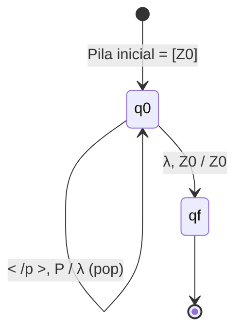

# Fase 2: Diseño Formal del Autómata a Pila ($M$)

**Materia:** Lenguajes Formales y Autómatas (2026)  
**Proyecto:** Analizador Sintáctico para MiniHTML  
**Documento:** Especificación Formal, Análisis Comparativo y Trazas de la Fase 2

---

## 1. Análisis de Enfoques de Diseño para el Autómata a Pila

En la teoría de autómatas existen distintas formas de modelar un reconocedor con pila para un lenguaje independiente de contexto. Antes de definir el autómata final, evaluamos rigurosamente las alternativas posibles para fundamentar la decisión de diseño.

### Alternativa 1: AP No Determinista (APND) Top-Down (Traducción directa de la GLC)
* **Mecanismo:** La pila almacena directamente los símbolos de la gramática ($V \cup \Sigma$). Comienza con el símbolo inicial $S$ en la pila y utiliza $\lambda$-transiciones para predecir y expandir las reglas de producción ($S \rightarrow E S$, $S \rightarrow \lambda$, etc.), desapilando los terminales a medida que coinciden con la entrada.
* **Ventajas:** Es una traducción algorítmica directa de la gramática formal $G$ de la Fase 1.
* **Desventajas:** Es **no determinista**. Requiere adivinar si expandir $S \rightarrow E S$ o $S \rightarrow \lambda$, o implementar un motor de *backtracking*. Para la implementación ejecutable de la Fase 3, resulta ineficiente e innecesariamente complejo.

### Alternativa 2: AP Determinista (APD) por Vaciado de Pila ($N(M)$)
* **Mecanismo:** El autómata no utiliza estados de aceptación finales ($F = \emptyset$). La cadena se acepta si y solo si, al consumir toda la entrada, la pila queda completamente vacía ($\text{Pila} = \lambda$, desapilando incluso el marcador de fondo $Z_0$).
* **Ventajas:** Modelo minimalista en cantidad de estados.
* **Desventajas:** El desapilado prematuro de $Z_0$ ante cadenas vacías o prefijos válidos puede generar estados de bloqueo irreparables, dificultando distinguir un documento bien cerrado de un error en etapas intermedias.

### Alternativa 3 (Seleccionada): AP Determinista (APD) por Estado Final con Marcador de Fondo ($L(M)$)
* **Mecanismo:** El autómata utiliza un alfabeto de pila específico $\Gamma = \{ Z_0, B, I, P \}$. Cada etiqueta de apertura apila su marcador correspondiente; el texto plano se procesa sin alterar la pila; y cada etiqueta de cierre desapila su marcador respectivo si coincide exactamente con el tope. La cadena se acepta si se consumió toda la entrada y el autómata alcanza el estado final de aceptación $q_f$ con la pila en su configuración inicial ($Z_0$).
* **Justificación de la elección:**
  1. **Determinismo estricto:** Para cada par $(\text{estado}, \text{símbolo entrada}, \text{tope pila})$ existe **a lo sumo una única transición**. No requiere conjeturas ni retroceso.
  2. **Complejidad óptima $O(n)$:** Procesa cada token en tiempo constante, siendo la base ideal para el *parser* de la Fase 3.
  3. **Diagnóstico preciso de errores:** Permite identificar exactamente qué etiqueta falló al comparar el token de cierre con el tope de la pila.

---

## 2. Definición Formal del Autómata a Pila ($M$)

Definimos formalmente el autómata a pila determinista como la 7-tupla:

$$M = (Q, \Sigma, \Gamma, \delta, q_0, Z_0, F)$$

Donde:

### 2.1. Conjunto Finito de Estados ($Q$)
$$Q = \{ q_0, q_f \}$$

* **$q_0$ (Estado de procesamiento / lectura):** Estado activo donde se leen las etiquetas, se apilan los marcadores y se emparejan los cierres. También es el estado en el que el documento está balanceado (con $Z_0$ en la pila).
* **$q_f$ (Estado final de aceptación):** Se alcanza mediante una transición vacía ($\lambda$) desde $q_0$ únicamente si la entrada terminó y el fondo de la pila $Z_0$ está intacto (garantía de que todas las etiquetas abiertas fueron cerradas).

### 2.2. Alfabeto de Entrada ($\Sigma$)
Los 7 terminales del lenguaje MiniHTML:
$$\Sigma = \{ \langle\text{b}\rangle, \langle\text{i}\rangle, \langle\text{p}\rangle, \langle/\text{b}\rangle, \langle/\text{i}\rangle, \langle/\text{p}\rangle, \text{TEXTO} \}$$

### 2.3. Alfabeto de la Pila ($\Gamma$)
$$\Gamma = \{ Z_0, B, I, P \}$$

* **$Z_0$:** Símbolo inicial de la pila (marcador de fondo). Indica que no hay etiquetas abiertas pendientes.
* **$B$:** Marcador de etiqueta de negrita abierta (`<b>`).
* **$I$:** Marcador de etiqueta de cursiva abierta (`<i>`).
* **$P$:** Marcador de etiqueta de párrafo abierta (`<p>`).

### 2.4. Símbolo Inicial de la Pila
$$Z_0 \in \Gamma$$

### 2.5. Estado Inicial
$$q_0 \in Q$$

### 2.6. Conjunto de Estados Finales ($F$)
$$F = \{ q_f \}$$

---

## 3. Función de Transición ($\delta$)

La función de transición tiene la forma:
$$\delta: Q \times (\Sigma \cup \{\lambda\}) \times \Gamma \rightarrow Q \times \Gamma^*$$

Convención de notación: si la pila tiene tope $X$ y se sustituye por $\alpha$:
* $\alpha = YX$: Operación **PUSH** (apilar $Y$ sobre $X$).
* $\alpha = X$: Operación **NO-OP** (conservar el tope $X$).
* $\alpha = \lambda$: Operación **POP** (desapilar $X$).

### Tabla Formal de Transiciones

| N° | Estado Actual ($q$) | Entrada ($a$) | Tope Pila ($X$) | Siguiente Estado ($q'$) | Nueva Pila ($\alpha$) | Operación sobre la Pila |
|:--:|:---:|:---:|:---:|:---:|:---:|:---|
| **1** | $q_0$ | `TEXTO` | $X \in \{Z_0, B, I, P\}$ | $q_0$ | $X$ | **Lectura neutra:** El texto plano no altera la pila. |
| **2** | $q_0$ | `<b>` | $X \in \{Z_0, B, I, P\}$ | $q_0$ | $BX$ | **Push:** Apila el marcador $B$ sobre el tope actual. |
| **3** | $q_0$ | `<i>` | $X \in \{Z_0, B, I, P\}$ | $q_0$ | $IX$ | **Push:** Apila el marcador $I$ sobre el tope actual. |
| **4** | $q_0$ | `<p>` | $X \in \{Z_0, B, I, P\}$ | $q_0$ | $PX$ | **Push:** Apila el marcador $P$ sobre el tope actual. |
| **5** | $q_0$ | `</b>` | $B$ | $q_0$ | $\lambda$ | **Pop:** Cierre exitoso de `<b>`. Desapila $B$. |
| **6** | $q_0$ | `</i>` | $I$ | $q_0$ | $\lambda$ | **Pop:** Cierre exitoso de `<i>`. Desapila $I$. |
| **7** | $q_0$ | `</p>` | $P$ | $q_0$ | $\lambda$ | **Pop:** Cierre exitoso de `<p>`. Desapila $P$. |
| **8** | $q_0$ | $\lambda$ | $Z_0$ | $q_f$ | $Z_0$ | **Aceptación:** Entrada consumida y pila balanceada. |

> **Comportamiento ante errores:** Cualquier combinación de (entrada, tope) no listada en la tabla (por ejemplo, leer `</b>` cuando el tope es $P$ o $Z_0$) no tiene transición definida ($\delta = \emptyset$). En ese caso el autómata **se bloquea inmediatamente**, rechazando la cadena por fallo de balanceo sintáctico.

---

## 4. Diagrama de Transición del Autómata



---

## 5. Trazas de Configuración Instantánea

Una **configuración instantánea** de un autómata a pila se denota como la terna:
$$(q, w, \gamma)$$
donde:
* $q \in Q$ es el estado actual.
* $w \in \Sigma^*$ es la cadena remanente por leer.
* $\gamma \in \Gamma^*$ es el contenido actual de la pila, donde el **primer símbolo a la izquierda representa el tope de la pila**.
* El símbolo $\vdash$ representa una transición de un paso, y $\vdash^*$ representa la clausura transitiva y reflexiva.

---

### 5.1. Traza para la Cadena $\alpha$

* **Cadena:** $\alpha = \text{<p> TEXTO <b> TEXTO </b> </p>}$

```text
Paso   Configuración Instantánea                                             Transición Aplicada
--------------------------------------------------------------------------------------------------------------------------
01.    (q0,  <p> TEXTO <b> TEXTO </b> </p>,                   Z0)             Configuración inicial
02.    |- (q0,  TEXTO <b> TEXTO </b> </p>,                   P Z0)            Regla 4: lee <p>, apila P sobre Z0
03.    |- (q0,  <b> TEXTO </b> </p>,                         P Z0)            Regla 1: lee TEXTO, conserva P
04.    |- (q0,  TEXTO </b> </p>,                           B P Z0)            Regla 2: lee <b>, apila B sobre P
05.    |- (q0,  </b> </p>,                                 B P Z0)            Regla 1: lee TEXTO, conserva B
06.    |- (q0,  </p>,                                        P Z0)            Regla 5: lee </b>, desapila B (pop)
07.    |- (q0,  λ,                                             Z0)            Regla 7: lee </p>, desapila P (pop)
08.    |- (qf,  λ,                                             Z0)            Regla 8: fin de entrada, pasa a estado qf
--------------------------------------------------------------------------------------------------------------------------
Resultado: Cadena ACEPTADA (qf ∈ F con entrada agotada y pila en Z0).
```

---

### 5.2. Traza para la Cadena $\beta$

* **Cadena:** $\beta = \text{<p> TEXTO <b> TEXTO </b> <i> TEXTO </i> </p>}$

```text
Paso   Configuración Instantánea                                             Transición Aplicada
--------------------------------------------------------------------------------------------------------------------------
01.    (q0,  <p> TEXTO <b> TEXTO </b> <i> TEXTO </i> </p>,    Z0)             Configuración inicial
02.    |- (q0,  TEXTO <b> TEXTO </b> <i> TEXTO </i> </p>,    P Z0)            Regla 4: lee <p>, apila P
03.    |- (q0,  <b> TEXTO </b> <i> TEXTO </i> </p>,          P Z0)            Regla 1: lee TEXTO, conserva P
04.    |- (q0,  TEXTO </b> <i> TEXTO </i> </p>,            B P Z0)            Regla 2: lee <b>, apila B
05.    |- (q0,  </b> <i> TEXTO </i> </p>,                  B P Z0)            Regla 1: lee TEXTO, conserva B
06.    |- (q0,  <i> TEXTO </i> </p>,                         P Z0)            Regla 5: lee </b>, desapila B (pop)
07.    |- (q0,  TEXTO </i> </p>,                           I P Z0)            Regla 3: lee <i>, apila I
08.    |- (q0,  </i> </p>,                                 I P Z0)            Regla 1: lee TEXTO, conserva I
09.    |- (q0,  </p>,                                        P Z0)            Regla 6: lee </i>, desapila I (pop)
10.    |- (q0,  λ,                                             Z0)            Regla 7: lee </p>, desapila P (pop)
11.    |- (qf,  λ,                                             Z0)            Regla 8: fin de entrada, pasa a estado qf
--------------------------------------------------------------------------------------------------------------------------
Resultado: Cadena ACEPTADA (qf ∈ F con entrada agotada y pila en Z0).
```

---

### 5.3. Traza para la Cadena $\gamma$

* **Cadena:** $\gamma = \text{<p> TEXTO TEXTO </p> <i> TEXTO </i>}$
* **Particularidad estructural:** Posee dos etiquetas hermanas consecutivas en el nivel raíz del documento y texto continuo dentro del párrafo.

```text
Paso   Configuración Instantánea                                             Transición Aplicada
--------------------------------------------------------------------------------------------------------------------------
01.    (q0,  <p> TEXTO TEXTO </p> <i> TEXTO </i>,             Z0)             Configuración inicial
02.    |- (q0,  TEXTO TEXTO </p> <i> TEXTO </i>,             P Z0)            Regla 4: lee <p>, apila P
03.    |- (q0,  TEXTO </p> <i> TEXTO </i>,                   P Z0)            Regla 1: lee primer TEXTO, conserva P
04.    |- (q0,  </p> <i> TEXTO </i>,                         P Z0)            Regla 1: lee segundo TEXTO, conserva P
05.    |- (q0,  <i> TEXTO </i>,                                Z0)            Regla 7: lee </p>, desapila P (pila vuelve a Z0)
06.    |- (q0,  TEXTO </i>,                                  I Z0)            Regla 3: lee <i>, apila I sobre Z0
07.    |- (q0,  </i>,                                        I Z0)            Regla 1: lee TEXTO, conserva I
08.    |- (q0,  λ,                                             Z0)            Regla 6: lee </i>, desapila I (pop)
09.    |- (qf,  λ,                                             Z0)            Regla 8: fin de entrada, pasa a estado qf
--------------------------------------------------------------------------------------------------------------------------
Resultado: Cadena ACEPTADA (qf ∈ F con entrada agotada y pila en Z0).
```

---

## 6. Demostración de Detección de Errores (Cadenas Inválidas)

Para contrastar el comportamiento del autómata ante violaciones sintácticas, analizamos la cadena inválida citada en la consigna:

$$\text{Inválida} = \text{<p> <b> TEXTO </p> </b>}$$

```text
Paso   Configuración Instantánea                                             Transición Aplicada / Evento
--------------------------------------------------------------------------------------------------------------------------
01.    (q0,  <p> <b> TEXTO </p> </b>,                         Z0)             Configuración inicial
02.    |- (q0,  <b> TEXTO </p> </b>,                         P Z0)            Lee <p>, apila P
03.    |- (q0,  TEXTO </p> </b>,                           B P Z0)            Lee <b>, apila B
04.    |- (q0,  </p> </b>,                                 B P Z0)            Lee TEXTO, conserva B
05.    BLOQUEO: Se intenta leer '</p>' pero el tope de la pila es 'B'.
       La función delta(q0, '</p>', B) está INDEFINIDA.
--------------------------------------------------------------------------------------------------------------------------
Resultado: Cadena RECHAZADA.
Diagnóstico formal: Error sintáctico de anidamiento. Se esperaba cerrar '<b>' (tope B), pero se recibió '</p>'.
```

---

## 7. Correspondencia Formal entre la GLC ($G$) y el Autómata ($M$)

Existe una correspondencia biunívoca entre la gramática de la Fase 1 y el autómata de la Fase 2:

| Concepto en Gramática Libre de Contexto ($G$) | Equivalente en Autómata a Pila ($M$) |
|:---|:---|
| **Regla $E \rightarrow \langle\text{tag}\rangle S \langle/\text{tag}\rangle$** | Operación **PUSH** al leer la apertura y **POP** al leer el cierre correspondiente. |
| **Anidamiento recursivo de $S$** | Crecimiento en profundidad de la memoria LIFO de la pila. |
| **Producción vacía $S \rightarrow \lambda$** | Desapilado exitoso hasta alcanzar el marcador contenedor o $Z_0$. |
| **Secuencia de elementos hermanos ($S \rightarrow E S$)** | Vaciado parcial de la pila hasta $Z_0$ y posterior apilado de la siguiente etiqueta hermana. |
| **Cadena vacía ($\lambda \in L(G)$)** | Transición directa $(q_0, \lambda, Z_0) \vdash (q_f, \lambda, Z_0)$. |
