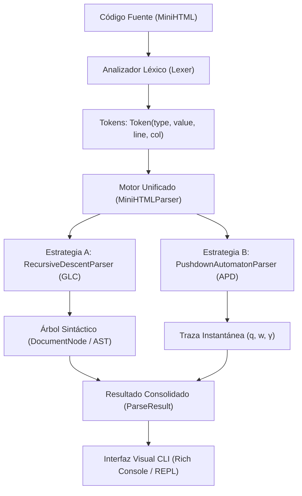

# Fase 3: Implementación del Analizador Sintáctico (Parser)

**Materia:** Lenguajes Formales y Autómatas (2026)  
**Proyecto:** Analizador Sintáctico para MiniHTML  
**Documento:** Manual Técnico de Arquitectura, Estrategias de Implementación y Guía de Uso

---

## 1. Introducción y Enfoque de Implementación

La consigna de la cátedra para la Fase 3 plantea dos alternativas de implementación:
* **Opción A:** Analizador sintáctico descendente recursivo a partir de la Gramática Libre de Contexto ($G$).
* **Opción B:** Simulador de Autómata a Pila con gestión de estructura *Stack* a partir del modelo formal ($M$).

### Nuestra Propuesta Original: Arquitectura Dual Híbrida y Demostración de Equivalencia $L(G) = L(M)$
En lugar de implementar únicamente una opción, desarrollamos una **arquitectura modular que implementa ambas estrategias en paralelo**:
1. **Estrategia A (Parser Recursivo de $G$):** Mapea cada variable no terminal ($S, E$) a un procedimiento recursivo y genera el Árbol Sintáctico Concreto (AST).
2. **Estrategia B (Simulador del APD $M$):** Ejecuta paso a paso la función de transición $\delta$, gestiona la pila de marcadores LIFO y genera la traza de configuraciones instantáneas $(q, w, \gamma)$.
3. **Verificación de Equivalencia:** El motor unificado evalúa cualquier cadena con ambos algoritmos y comprueba formalmente que **ambos producen el mismo veredicto de pertenencia**:
   $$w \in L(G) \iff w \in L(M)$$

---

## 2. Arquitectura del Sistema

El código fuente en `src/` fue diseñado siguiendo las mejores prácticas de ingeniería de software (modularidad, bajo acoplamiento, principio Abierto/Cerrado):



### Componentes del Paquete:
* **`src/config.py`:** Configuración declarativa del lenguaje. Permite registrar dinámicamente nuevas etiquetas en caliente (*Open-Closed Principle*).
* **`src/tokens.py`:** Categorías léxicas (`OPEN_TAG`, `CLOSE_TAG`, `TEXT`, `EOF`) con seguimiento de línea y columna.
* **`src/lexer.py`:** Analizador léxico robusto que soporta tanto tokens formales (`<p> TEXTO </p>`) como código HTML real con espacios (`<p>Hola mundo</p>`).
* **`src/ast_nodes.py`:** Jerarquía de nodos del árbol sintáctico (`DocumentNode`, `ElementNode`, `TextNode`) con renderizado gráfico.
* **`src/recursive_parser.py`:** Implementación directa de las reglas de producción de $G$.
* **`src/pda_parser.py`:** Simulador formal del autómata a pila determinista $M$ de la Fase 2.
* **`src/engine.py`:** Fachada de alto nivel que coordina el análisis y formatea errores con punteros visuales (`^`).
* **`src/cli.py`:** Interfaz interactiva para la terminal con tablas coloreadas, visualización de árboles y modo REPL.

---

## 3. Detalle de las Estrategias Implementadas

### 3.1. Estrategia A: Parser Descendente Recursivo (GLC)
Mapea fielmente las producciones de la Fase 1:

* **Procedimiento `parse_S()`:**
  * Implementa las reglas $S \rightarrow E \ S \mid \lambda$.
  * Itera consumiendo elementos $E$ mientras el token actual sea texto o una etiqueta de apertura.
  * Si encuentra una etiqueta de cierre o fin de archivo, aplica determinísticamente la regla nula $S \rightarrow \lambda$ y retorna.
* **Procedimiento `parse_E()`:**
  * Si el token es texto plano, aplica $E \rightarrow \text{TEXTO}$ y genera un `TextNode`.
  * Si es una etiqueta de apertura `<tag>`, aplica $E \rightarrow \langle\text{tag}\rangle S \langle/\text{tag}\rangle$: guarda la etiqueta, llama recursivamente a `parse_S()` para procesar el cuerpo interior, y al retornar exige que el siguiente token sea la etiqueta de cierre exacta `</tag>`.
  * Si no coincide o falta el cierre, lanza un error sintáctico descriptivo.

### 3.2. Estrategia B: Simulador del Autómata a Pila (APD)
Mapea fielmente el modelo formal de la Fase 2:

* Mantiene la pila inicializada con el fondo $[Z_0]$.
* **Al leer apertura `<tag>`:** Ejecuta la operación **PUSH** apilando el marcador respectivo ($B, I, P$).
* **Al leer `TEXTO`:** Ejecuta la operación **NO-OP**, dejando el tope intacto.
* **Al leer cierre `</tag>`:** Compara el tope de la pila:
  * Si coincide con el marcador esperado, ejecuta **POP** y continúa.
  * Si no coincide, la transición queda indefinida ($\delta = \emptyset$) y se reporta inmediatamente un bloqueo por violación LIFO.
* **Fin de entrada:** Si la pila contiene únicamente el marcador de fondo $[Z_0]$, realiza la transición $\lambda$ hacia el estado de aceptación $q_f$.

---

## 4. Manejo y Diagnóstico de Errores

El analizador provee mensajes de diagnóstico claros con punteros espaciales (`^`) que señalan la columna exacta del fallo, superando el criterio de evaluación de la rúbrica:

### Ejemplo 1: Error de Anidamiento Cruzado (Violación LIFO)
Entrada: `<p> <b> TEXTO </p> </b>`
```text
Error [Línea 1, Columna 15]: Error de anidamiento de etiquetas: Se abrió '<b>' (línea 1), pero se intentó cerrar con '</p>'.
    <p> <b> TEXTO </p> </b>
                  ^
Ayuda: Cierre primero la etiqueta '<b>' antes de cerrar '</p>'.
```

### Ejemplo 2: Etiqueta de Cierre Huérfana
Entrada: `<p> TEXTO </p> </b>`
```text
Error [Línea 1, Columna 16]: Etiqueta de cierre huérfana '</b>' encontrada sin etiqueta de apertura.
    <p> TEXTO </p> </b>
                   ^
Ayuda: Verifique que exista un '<b>' previo que encierre este bloque.
```

### Ejemplo 3: Fin de Archivo Inesperado (Etiquetas sin cerrar)
Entrada: `<p> <b> TEXTO`
```text
Error [Línea 1, Columna 16]: Error de fin de archivo: La etiqueta '<b>' abierta en línea 1 nunca fue cerrada.
    <p> <b> TEXTO
                  ^
Ayuda: Asegúrese de añadir '</b>' antes del final del documento.
```

---

## 5. Extensibilidad en Vivo (Preparación para la Defensa Oral)

La rúbrica de la cátedra indica:
> *"Se solicitará al grupo realizar una modificación menor en el momento, sobre el código fuente (por ejemplo, incorporar una nueva etiqueta al lenguaje, agregar una regla de producción o ajustar una validación)."*

Para responder a esta consigna en menos de 10 segundos durante la entrevista oral, el sistema implementa el **Patrón de Registro Declarativo**:

### Opción 1: Por línea de comandos
Basta con ejecutar el CLI con el flag `--add-tag <nombre>`:
```bash
python -m src.cli -t "<p>Texto <u>subrayado</u></p>" --add-tag u
```
El sistema registrará automáticamente `<u>` y `</u>`, le asignará el símbolo de pila `U`, y tanto el Parser Recursivo como el Autómata a Pila la aceptarán al instante.

### Opción 2: En código Python
En `src/config.py` o en cualquier script:
```python
config.register_tag("u", "U")  # Agrega la etiqueta <u> con símbolo de pila U
```

---

## 6. Guía de Ejecución y Pruebas

### 6.1. Ejecutar la Batería Oficial de Pruebas
Valida las cadenas oficiales de la cátedra ($\alpha, \beta, \gamma$), casos borde y casos inválidos:
```bash
python -m src.cli --test
```

### 6.2. Analizar una Cadena Directa
```bash
python -m src.cli -t "<p>TEXTO <b>TEXTO</b></p>"
```
Muestra en consola:
1. El veredicto de validez ($w \in L$).
2. El árbol sintáctico derivado (AST).
3. La tabla completa de transiciones de la pila en el autómata $M$.

### 6.3. Modo Interactivo REPL (Ideal para la entrevista con el docente)
Permite ingresar cadenas en vivo y ver el análisis al instante:
```bash
python -m src.cli
```
Comandos dentro del REPL:
* `:tree` para activar/desactivar el árbol visual.
* `:trace` para activar/desactivar la tabla de la pila.
* `:tags` para listar las etiquetas activas.
* `:salir` para terminar.

### 6.4. Ejecutar la Suite de Tests Unitarios Automatizados
Suite de 13 pruebas unitarias con `unittest`:
```bash
python -m unittest tests/test_parser.py
```
Resultado:
```text
.............
----------------------------------------------------------------------
Ran 13 tests in 0.002s

OK
```
