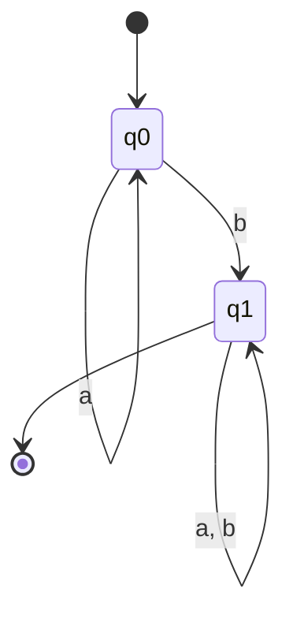
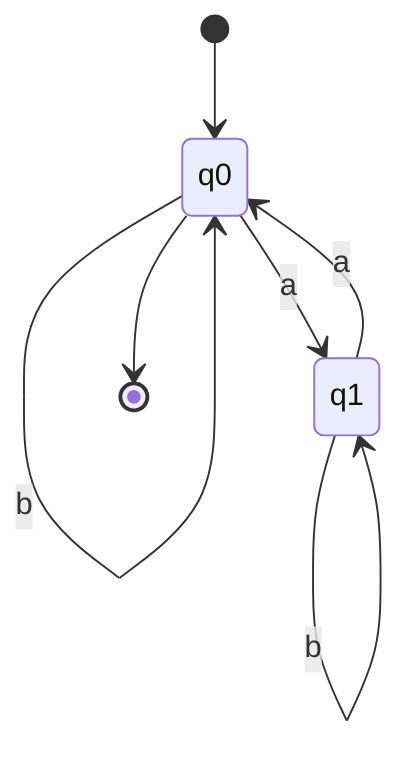
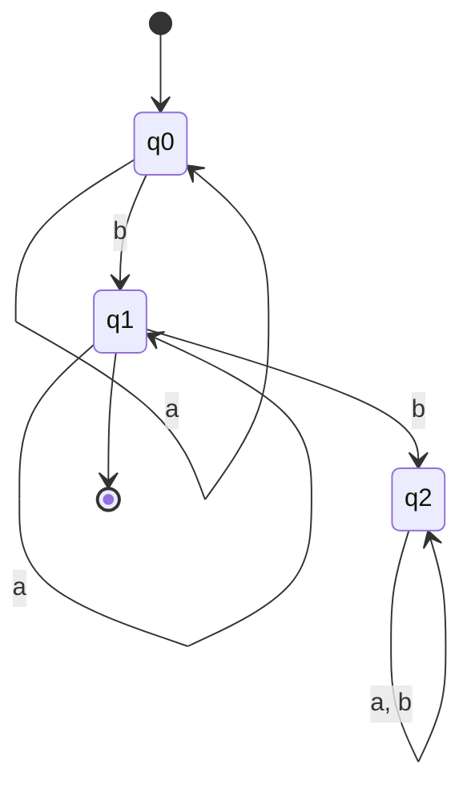
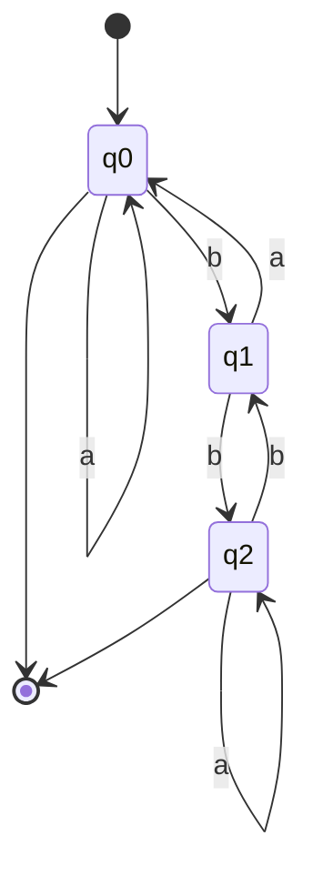

# Clase 3: Autómatas Finitos Deterministas (AFD)

> **Materia:** Lenguajes Formales y Autómatas  
> **Institución:** Universidad Católica de Córdoba (UCC)  
> **Año:** 2026  
> **Documento base:** `clase3 2026.pdf` (Clase 3)

---

## 1. ¿Cómo Reconocer Lenguajes? Ejemplos Introductorios (Diapositivas 2 - 8)

Un reconocedor procesa una cadena de entrada carácter por carácter y responde si pertenece o no al lenguaje al finalizar la lectura.

### Problema 1: Cadenas que contienen al menos una 'b' sobre $\Sigma = \{a, b\}$
- **Pregunta:** ¿$aaabb \in L$? $\implies$ Sí.
- **Modelado de Estados:** Mientras leo la cadena, puedo estar en alguno de estos dos estados:
  - $q_0$: Aún no leí ninguna 'b' (estado inicial, no de aceptación).
  - $q_1$: Ya leí al menos una 'b' (estado de aceptación / absorbente).
- **Criterio:** La cadena se acepta si al terminar de leer estamos en el estado $q_1$.

### Problema 2: Cadenas con una cantidad par de 'a' sobre $\Sigma = \{a, b\}$
- **Pregunta:** ¿$abaabb \in L$? $\implies$ No ($|abaabb|_a = 3$, impar).
- **Modelado de Estados:**
  - $q_0$: Llevo leída una cantidad par de 'a' (inicial y de aceptación).
  - $q_1$: Llevo leída una cantidad impar de 'a' (no de aceptación).
- **Criterio:** La cadena se acepta si al terminar de leer estamos en el estado $q_0$.

### Problema 3: Cadenas que tienen exactamente una sola 'b' sobre $\Sigma = \{a, b\}$
- **Pregunta:** ¿$aababa \in L$? $\implies$ No (tiene dos 'b').
- **Modelado de Estados:**
  - $q_0$: No encontré ninguna 'b' hasta ahora.
  - $q_1$: Leí exactamente una sola 'b' hasta ahora (estado de aceptación).
  - $q_2$: Leí más de una 'b' hasta ahora (**estado pozo / trampa**).
- **Criterio:** La cadena se acepta si al terminar de leer estamos en el estado $q_1$.

---

## 2. Concepto y Funcionamiento de los Autómatas (Diapositivas 9 - 11)

- Los autómatas son **máquinas abstractas** con capacidad de computación.
- Los autómatas finitos procesan (leen) secuencialmente cadenas de entrada, carácter por carácter, sobre una **cinta de entrada**, para dar una respuesta Sí/No.
- Poseen una **unidad de control** con un número finito de configuraciones internas denominadas **estados**. Entre ellos se destacan el **estado inicial** y los **estados finales o de aceptación**.
- Cada lectura provoca un cambio de estado denominado **transición**.
- **Configuración inicial $\implies$ Pasos computacionales $\implies$ Trayectoria de operación $\implies$ Decisión final.**

---

## 3. Definición Formal de un AFD (Diapositivas 12 - 13)

Un **Autómata Finito Determinístico (AFD)** es una 5-tupla:
$$M = (\Sigma, Q, q_0, F, \delta)$$
Donde:
- $\Sigma$: Alfabeto finito de entrada.
- $Q$: Conjunto finito y no vacío de estados.
- $q_0 \in Q$: Estado inicial.
- $F \subseteq Q$: Conjunto de estados de aceptación o finales.
- $\delta: Q \times \Sigma \to Q$: Función de transición total (o parcial).
  $$\delta(q, a) = q'$$
  significa que estando en el estado $q$, al leer el símbolo $a$, transiciona determinísticamente al estado $q'$.

### Aceptación y Lenguaje ($L(M)$):
Una cadena $\alpha \in \Sigma^*$ es aceptada por $M$ si partiendo de $q_0$ y procesando toda la cadena, el estado final alcanzado pertenece a $F$:
$$L(M) = \{\alpha \in \Sigma^* : \delta^*(q_0, \alpha) \in F\}$$

---

## 4. Representación mediante Tabla y Diagrama (Diapositivas 14 - 15)

Sea el autómata $M = (\Sigma, Q, q_0, F, \delta)$ con:
- $\Sigma = \{a, b\}$
- $Q = \{q_0, q_1, q_2\}$
- $q_0$: Estado inicial
- $F = \{q_0, q_2\}$ (dos estados finales)

### Tabla de Transición $\delta$:
| Estado ($q$) | Entrada $a$ | Entrada $b$ |
|:---:|:---:|:---:|
| $\to * q_0$ | $q_0$ | $q_1$ |
| $q_1$ | $q_0$ | $q_2$ |
| $* q_2$ | $q_2$ | $q_1$ |

*(Nota: $\to$ indica estado inicial, $*$ indica estado final)*

- **Cadenas aceptadas:** $\lambda$, $a$, $aa$, $bb$, $abb$, $ba$, $bba$, etc.
- **Cadenas no aceptadas:** $b$, $ab$, $aab$, $bab$, etc.

---

## 5. Estados Pozo y Función Parcial vs. Total (Diapositivas 16 - 22)

### 5.1 Estado Pozo o Trampa (*Sink State*)
Un estado $q_p \in Q - F$ es absorbente: una vez alcanzado, todas las transiciones permanecen en él ($\forall a \in \Sigma, \delta(q_p, a) = q_p$). Representa el rechazo irreversible de cadenas no válidas.

### 5.2 Versión Simplificada con Función Parcial:
En un autómata simplificado, la función de transición es **parcial** (no está definida para todos los pares $(q, a)$).  
- Si el autómata lee un carácter para el cual $\delta(q, a)$ no existe, la máquina **se bloquea (*tilda*)** y la cadena no es aceptada.
- **Equivalencia:** Ambos autómatas (con función total y estado pozo, o con función parcial sin estado pozo) reconocen **exactamente el mismo lenguaje**.

### 5.3 Conversión de Parcial a Total (Diapositiva 22):
Dado un AFD parcial $M = (\Sigma, Q, q_0, F, \delta_{\text{par}})$, se construye el AFD total equivalente $M' = (\Sigma, Q', q_0, F, \delta_{\text{tot}})$:
1. $Q' = Q \cup \{q_p\}$ (se agrega el estado pozo $q_p$).
2. $\delta_{\text{tot}} = \delta_{\text{par}} \cup \{((q, a), q_p) : \text{no existe } \delta_{\text{par}}(q, a)\} \cup \{((q_p, a), q_p) : \forall a \in \Sigma\}$.

---

## 6. Autómata para el Complemento $L(M)^c$ (Diapositivas 23 - 25)

Dado un AFD $M = (\Sigma, Q, q_0, F, \delta)$, ¿cómo construimos $M^c$ tal que $L(M^c) = \Sigma^* - L(M)$?

> [!IMPORTANT]
> $M^c$ debe aceptar:
> 1. Cadenas que en $M$ terminaban en un estado no final.
> 2. Cadenas que en $M$ se bloqueaban.
> 
> Para que esto funcione rigurosamente por inversión de estados finales, **la función de transición debe ser TOTAL**.

### Procedimiento:
1. Completar la función de transición agregando el estado pozo $q_p$.
2. Invertir los estados de aceptación:
   $$F^c = Q' - F$$
   *(El estado pozo $q_p$, al no ser final en $M$, pasa a ser estado final de aceptación en $M^c$).*

### Ejemplo de Cátedra (Diapositiva 25):
- **Lenguaje original $L$:** Cadenas no vacías con $a$ y $b$ alternadas ($ab, ba, aba, bab, \dots$).
- **$M$ parcial:** Estados $q_0 \xrightarrow{a} q_1 \xrightarrow{b} q_2$ y $q_0 \xrightarrow{b} q_3 \xrightarrow{a} q_4$.
- **$M$ total:** Transiciones a caracteres repetidos ($aa, bb$) van al estado pozo $q_p$.
- **$M^c$ complementario:** Acepta $\lambda$ (pues $q_0$ pasa a ser final) y cadenas que no alternan $a$ y $b$ (terminan en $q_p$, que ahora es final).

---

## 7. Bibliografía de la Cátedra (Diapositiva 26)

- **Rodrigo De Castro Korgi:** *Teoría de la computación. Lenguajes, autómatas, gramáticas*. Capítulo 1: Alfabetos, cadenas y lenguajes. Secciones 2.1 a 2.3 (ejemplos pág. 30-31).
- **Peter Linz:** *An Introduction to Formal Languages and Automata*. Capítulo 2.1.
- **Lorena Bergamini:** *Autómatas, Lenguajes y Gramáticas*.
